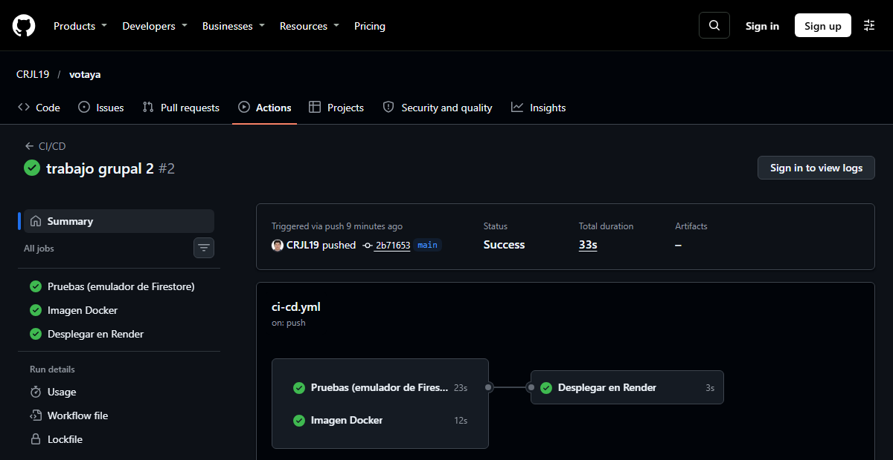

# De git push a producción: desplegar una app con Firestore usando GitHub Actions, un emulador y Render

**Autor:** Arturo Cutipa Flores
**Curso:** Base de Datos II · Universidad Privada de Tacna
**Actividad:** Grupal 01-U2, NoSQL App Development, desarrollada junto con Carlos Jimenez Laura

Una pregunta incómoda aparece al automatizar una app con base de datos en la nube: ¿cómo la pruebas en CI sin tocar los datos reales ni gastar la cuota? En este artículo cuento cómo resolvimos eso en **VotaYa**, nuestra app de encuestas en vivo sobre **Google Cloud Firestore**, para que un simple `git push` termine en producción solo si todo funciona.

## Enlaces del proyecto

- **Aplicación:** https://votaya-firestore.onrender.com
- **Repositorio público:** https://github.com/CRJL19/votaya
- **Video:** `[enlace al video]`

## El recorrido

```
git push a main
   │
   ▼
GitHub Actions
   ├─ Pruebas contra el emulador de Firestore
   ├─ Construcción de la imagen Docker
   └─ Si ambas pasan: POST al Deploy Hook de Render
                          │
                          ▼
                 Render publica la nueva versión
                          │
                          ▼
                 Firestore (Google Cloud)
```

| Requisito de la actividad | Cómo lo cumplimos |
|---|---|
| Base NoSQL permitida | Google Cloud Firestore |
| Repositorio público | GitHub |
| Implementación automatizada | GitHub Actions |
| Nube pública o SaaS | Render y Firebase, ambos en plan gratuito |

## Probar sin la nube: el emulador

Firebase ofrece un emulador oficial de Firestore. Es un programa en Java que se ejecuta en local y responde igual que el servicio real, sin credenciales. El proyecto usa un ID que empieza por `demo-`, para que el emulador nunca intente conectarse a servicios reales:

```json
"test": "firebase emulators:exec --only firestore --project demo-votaya \"node --test test/api.test.js\""
```

`emulators:exec` levanta el emulador, ejecuta las pruebas y lo apaga al terminar.

Elegimos no simular la base con mocks. Las 15 pruebas llaman a la API real por HTTP, y eso nos dio algo que un mock nunca habría mostrado: la prueba de 10 votos simultáneos reveló que nuestra primera versión tardaba 11,6 segundos. Carlos explica ese problema en su artículo.

También probamos los casos que solo fallan bajo presión:

- El mismo votante enviando 5 votos en paralelo cuenta solo una vez.
- Tras 10 votos simultáneos, el total coincide con los documentos guardados.
- Los resultados en vivo llegan por Server-Sent Events.
- Al borrar una encuesta también se borran sus votos.

## El pipeline

`.github/workflows/ci-cd.yml` tiene tres trabajos. Las pruebas necesitan Node y Java:

```yaml
- uses: actions/setup-node@v5
  with:
    node-version: 24
    cache: npm

- uses: actions/setup-java@v5
  with:
    distribution: temurin
    java-version: 21

- run: npm ci
- run: npm run check
- run: npm test
```

El despliegue depende de los otros dos trabajos, y nunca corre desde un pull request:

```yaml
deploy:
  needs: [test, docker]
  if: github.ref == 'refs/heads/main' && github.event_name != 'pull_request'
```

En nuestra ejecución tardaron 23 s las pruebas, 12 s la imagen Docker y 3 s disparar el despliegue.



## La infraestructura también va en el repositorio

El servicio de Render está definido en `render.yaml`:

```yaml
services:
  - type: web
    name: votaya-firestore
    runtime: docker
    plan: free
    autoDeploy: false
    healthCheckPath: /api/health
    envVars:
      - key: NODE_ENV
        value: production
      - key: FIREBASE_SERVICE_ACCOUNT
        sync: false
```

Dos líneas importan especialmente:

- **`autoDeploy: false`:** Render no despliega por su cuenta al detectar un cambio. El único camino a producción pasa por las pruebas.
- **`sync: false`:** Render pide la credencial al crear el servicio y su valor nunca queda en el repositorio.

## Credenciales: el mínimo permiso

Lo cómodo habría sido usar la cuenta de servicio de administrador que propone Firebase. Al intentar crearla desde la consola nos apareció un aviso de error vacío. La salida fue crear nuestra propia cuenta de servicio en Google Cloud, y resultó ser mejor opción:

1. Cuenta `votaya-app`, con un único rol: **Usuario de Cloud Datastore**.
2. Una clave JSON guardada fuera del proyecto.
3. El contenido de esa clave, pegado como variable de entorno en Render.

Si esa clave se filtrara, daría acceso a los datos de Firestore, pero no permitiría administrar el resto del proyecto.

En `.gitignore` y `.dockerignore` excluimos además los patrones de nombre de estas claves, para evitar subirlas por accidente. Y GitHub solo guarda un secret, `RENDER_DEPLOY_HOOK`, porque el CI no necesita acceso a la base: prueba contra el emulador.

## Probar lo que se desplegó

Una vez en verde no dimos el despliegue por bueno: probamos la URL pública contra Firestore real.

| Comprobación en producción | Resultado |
|---|---|
| Conexión con Firestore (`/api/health/ready`) | `200`, base disponible |
| Crear una encuesta | `201` |
| Votar | `201` |
| Votar de nuevo con el mismo votante | `409` |
| 10 votos simultáneos | Los 10 registrados, en cerca de 2 s |
| Resultados en vivo | Recibidos por la conexión SSE |
| Cerrar sin token | `403` |
| Votar en una encuesta cerrada | `409` |
| Eliminar con token | `204` |

También comprobamos en un navegador limpio que un voto externo actualiza la pantalla sin recargar y que la página no se desborda en tamaño de celular.

## Lo que aprendimos en el camino

- **Un paso en rojo puede ser lo esperado.** La primera ejecución falló en el despliegue porque aún no existía el secret del Deploy Hook. Preferimos que falle a que parezca desplegado sin estarlo.
- **La inspección visual sigue haciendo falta.** Las pruebas de la API pasaban, pero una captura mostró los botones de administrador a cualquier visitante: `display: flex` anulaba el atributo `hidden`. El servidor los rechazaba igual, pero no debían verse.
- **Los health checks tienen costo.** Render consulta el suyo periódicamente. Si leyera Firestore, gastaría la cuota gratuita, así que `/api/health` no toca la base.

## Limitaciones del plan gratuito

- La instancia de Render se duerme tras un rato sin tráfico, y la primera visita puede tardar cerca de un minuto.
- Firestore Spark permite 50 000 lecturas y 20 000 escrituras al día, suficiente para una demo pero no para un producto real.

## Conclusión

Lo que más valor tuvo fue el emulador: hizo posible un pipeline completo sin credenciales de la base en el CI. Con eso, `git push` dejó de ser un riesgo, porque si algo falla no llega a producción.

Para el detalle del modelo de datos y por qué abandonamos las transacciones, recomiendo el artículo de Carlos.
