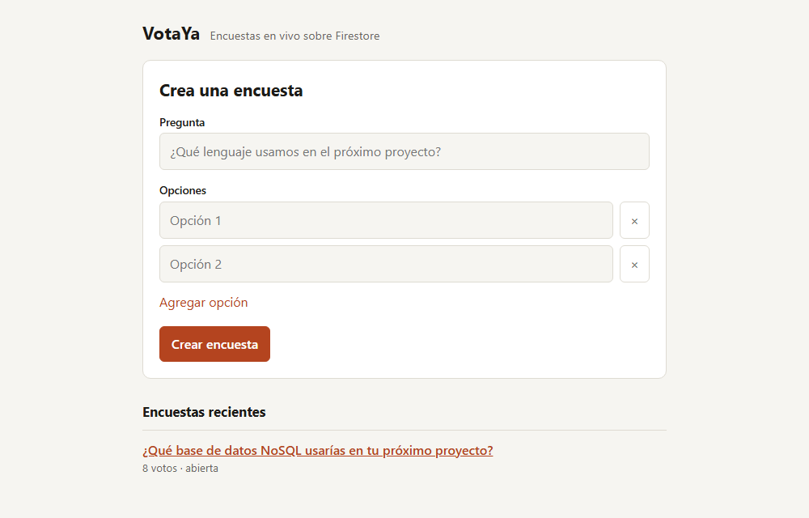
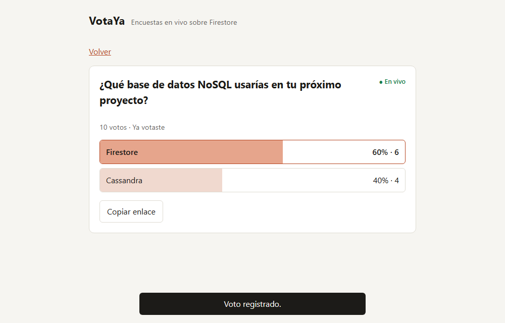

# Modelar para NoSQL: cómo construimos encuestas en vivo con Firestore y por qué una transacción nos estorbaba

**Autor:** Carlos Jimenez Laura
**Curso:** Base de Datos II · Universidad Privada de Tacna
**Actividad:** Grupal 01-U2, NoSQL App Development, desarrollada junto con Arturo Cutipa Flores

Veníamos de trabajar con bases relacionales, y nuestro primer instinto fue pensar en tablas: una de encuestas, otra de opciones, otra de votos y un `GROUP BY` para los resultados. En Firestore ese diseño funciona mal. En este artículo cuento cómo construimos **VotaYa**, una app de encuestas con resultados en vivo, y qué decisiones cambian cuando la base de datos es NoSQL.

La actividad pedía evitar Redis, MongoDB, Neo4j y Prometheus, así que elegimos **Google Cloud Firestore**, una base de documentos.

## Enlaces del proyecto

- **Aplicación:** https://votaya-firestore.onrender.com
- **Repositorio público:** https://github.com/CRJL19/votaya
- **Video:** `[enlace al video]`



## Por qué Firestore

Comparamos tres opciones que cumplían la restricción:

| Opción | A favor | En contra para este proyecto |
|---|---|---|
| **Firestore** | Plan gratuito sin tarjeta y emulador oficial para pruebas | Límite de escrituras por documento |
| DynamoDB | Infraestructura como código en AWS | Exige una cuenta propia con tarjeta |
| Astra DB (Cassandra) | Muy escalable | Sin un emulador local equivalente |

El emulador pesó mucho: nos permitió probar contra el motor real de Firestore sin tocar la nube ni gastar cuota.

## En NoSQL se modela a partir de las consultas

La pantalla más visitada muestra una encuesta con sus resultados. Con un diseño relacional, cada carga contaría votos. En Firestore pagas por documento leído, así que contar 1 000 votos costaría 1 000 lecturas.

Por eso guardamos los contadores dentro de la propia encuesta:

```
polls/{pollId}
  question: "¿Qué base NoSQL usarías?"
  options:  [{ id: "o1", text: "Firestore" }, { id: "o2", text: "Cassandra" }]
  counts:   { o1: 5, o2: 3 }
  totalVotes: 8
  status: "open"
  adminTokenHash: "..."
  createdAt: Timestamp

polls/{pollId}/votes/{voterId}
  optionId: "o1"
  votedAt: Timestamp
```

Mostrar los resultados cuesta ahora **una sola lectura**, sin importar cuántos votos existan. Es desnormalizar a propósito: el dato se duplica y el trabajo se paga al escribir. En una aplicación donde se lee mucho más de lo que se vota, el cambio sale a cuenta.

Los votos van en una subcolección, y el identificador del votante es el identificador del documento. Así la unicidad la garantiza la propia clave, sin consultar antes.

## La transacción que nos estorbaba

Mi primera versión del voto usaba una transacción, lo que parecía la opción correcta: leer la encuesta, leer si el votante ya existe, escribir ambas cosas.

Las pruebas pasaban, pero una llamaba la atención: **10 votos simultáneos tardaban 11,6 segundos** en el emulador. Sin esa prueba de concurrencia no lo habríamos visto. La transacción leía el documento de la encuesta, de modo que los votos competían por él y se reintentaban una y otra vez.

Lo que resolvió el problema fue preguntarnos si de verdad necesitábamos leer dentro de la operación. No hacía falta:

- `FieldValue.increment()` suma sin conocer el valor anterior.
- `create()` falla por sí solo si el documento del votante ya existe.

Eso permite usar un **batch atómico**, sin lecturas y por tanto sin bloqueos:

```javascript
const batch = db.batch();
batch.create(ref.collection('votes').doc(voterId), {
  optionId,
  votedAt: FieldValue.serverTimestamp(),
});
batch.update(ref, {
  [`counts.${optionId}`]: FieldValue.increment(1),
  totalVotes: FieldValue.increment(1),
});
await batch.commit();
```

Las dos escrituras ocurren juntas o no ocurren. Si alguien vota dos veces, `create()` falla, se cancela todo el batch y el contador no se infla, aunque las peticiones lleguen a la vez.

| Medición: 10 votos simultáneos | Tiempo |
|---|---|
| Transacción, en el emulador | 11,6 s |
| Batch atómico, en el emulador | 89 ms |
| Batch atómico, en producción con Firestore real | cerca de 2 s |

La cifra de producción incluye la red y el servidor, así que no es comparable con las otras dos. Lo importante es que los 10 votos se registraron y el total coincidió.

Hay una concesión: el estado de la encuesta se comprueba antes del batch, por lo que un voto que coincida justo con el cierre aún puede contar. En una encuesta es aceptable. En un sistema de pagos no lo sería.

## Resultados en vivo sin gastar la cuota

Firestore puede avisar de cada cambio en un documento mediante listeners, y eso hace que los resultados se actualicen solos. El navegador no se conecta a Firestore directamente: el servidor escucha y reenvía por **Server-Sent Events**.



Una primera idea era un listener por cada navegador, pero Firestore cobra cada documento entregado a cada listener. Con 50 personas mirando, cada voto costaría 50 lecturas. Por eso el servidor mantiene **un solo listener por encuesta** y lo reparte a todos los conectados; una prueba automática lo verifica.

El mismo razonamiento se aplicó al health check. Render lo consulta periódicamente y, si cada consulta leyera Firestore, gastaría cuota solo en comprobaciones. Separamos `/api/health`, que no toca la base, de `/api/health/ready`, que sí la comprueba.

## Seguridad

- El navegador nunca habla con Firestore, y `firestore.rules` deniega cualquier acceso directo.
- Cerrar o borrar una encuesta exige un token que se entrega solo a quien la crea. En la base se guarda únicamente su hash.
- Hay límite de peticiones por IP y cabeceras de seguridad con Helmet.

## Despliegue automático en la nube

La aplicación está publicada en **Render**, un proveedor público, con su base en **Firestore**, en Google Cloud. No la desplegamos a mano: cada `git push` a `main` ejecuta un workflow de **GitHub Actions** con tres pasos:

1. Pruebas de integración contra el emulador oficial de Firestore.
2. Construcción de la imagen Docker.
3. Si ambos pasan, una llamada al Deploy Hook de Render, que publica la nueva versión.

El despliegue automático propio de Render está desactivado (`autoDeploy: false` en `render.yaml`), de modo que el único camino a producción pasa por las pruebas. La credencial de Firestore se configura como variable de entorno en Render y nunca entra al repositorio.

## Limitaciones

Prefiero dejarlas claras:

- **Un voto por navegador, no por persona.** Quien borre sus datos locales puede votar de nuevo. Evitarlo exigiría iniciar sesión.
- **Escrituras por documento.** Google recomienda no sostener más de una por segundo sobre un mismo documento, y aquí todos los votos actualizan el mismo. Una encuesta masiva necesitaría repartir los contadores en varios documentos.
- **Borrar no es en cascada.** Eliminar un documento no borra sus subcolecciones, así que usamos `recursiveDelete`.

## Qué me llevo

Lo que más me sirvió fue dejar de preguntar "¿cómo guardo esto?" y empezar por "¿cómo se va a leer?". Y la transacción lenta me enseñó otra cosa: el diseño más seguro en apariencia no siempre es el correcto, y una prueba de concurrencia lo detecta antes que un usuario.

Mi compañero Arturo cuenta en su artículo la otra mitad del proyecto: cómo lo probamos y lo desplegamos de forma automática.
